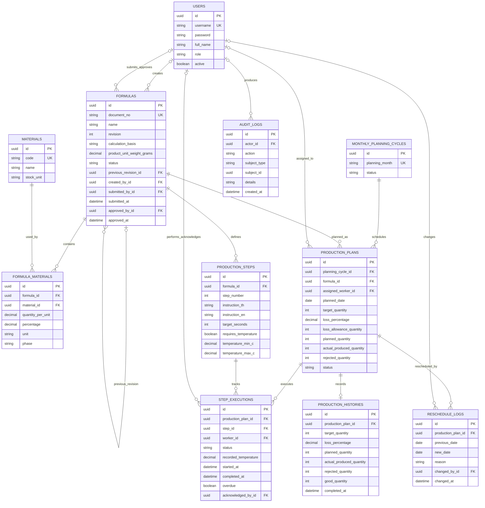

# Formula Base — ER Diagram

Notes:

- `FORMULA_MATERIALS` is the junction table between formulas and materials.
- `PRODUCTION_STEPS` holds bilingual production instructions and QC-defined temperature limits.
- A production plan snapshots the planned batch, including its Worker-entered loss allowance.
- `STEP_EXECUTIONS` records the execution of every formula step within a production plan.
- `PRODUCTION_HISTORIES` has a one-to-one relationship with a completed production plan.
